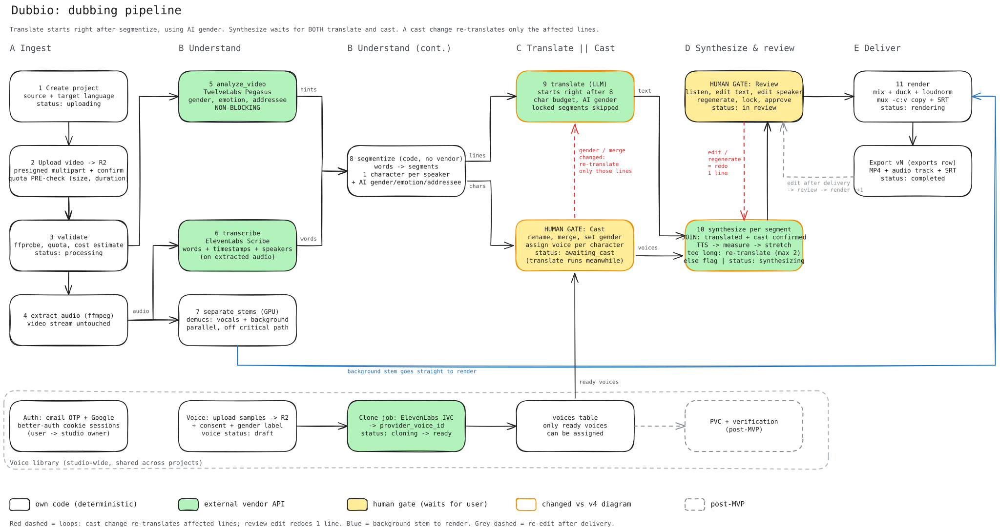

# Dubbio Backend

Dubbio is the backend for an AI-assisted video dubbing studio. It manages
studio access, a shared voice library, project ingestion, the dubbing pipeline,
human review gates, and versioned exports.

The design favors asynchronous, resumable pipeline stages: paid vendor calls are
cached, interrupted polling can resume, and the source video stream is left
untouched until the final render.

> **Project status:** early development. The NestJS bootstrap, environment
> validation, PostgreSQL schema and relations, job queues, worker process, mock
> vendor providers, Docker setup, and Better Auth email OTP and Google sign-in
> are in place. Route protection, the business HTTP API, pipeline execution, and
> real vendor integrations are not implemented yet.

## Architecture



The table describes the target architecture. The NestJS bootstrap, environment
validation, database schema and relations, job queues, worker process, mock
providers, Docker setup, and Better Auth email OTP and Google sign-in exist in
code today; business API behavior and real vendor integrations are still
planned.

| Component              | Responsibility                                                          |
| ---------------------- | ----------------------------------------------------------------------- |
| NestJS API             | HTTP boundary, authentication, studio/project/voice management, uploads |
| PostgreSQL 18          | Transactional state, pipeline runs, segment versions, exports           |
| Drizzle ORM            | Typed schema, relational queries, SQL migrations                        |
| Cloudflare R2          | Source videos, voice samples, stems, segment audio, rendered exports    |
| Better Auth            | Cookie sessions, email OTP (development delivery), Google OAuth         |
| ffmpeg / ffprobe       | Validation, audio extraction, mixing, muxing                            |
| TwelveLabs Pegasus     | Video analysis: gender, emotion, addressee hints                        |
| ElevenLabs Scribe      | Transcription with words, timestamps, and speaker labels                |
| ElevenLabs IVC         | Instant voice cloning from consented samples                            |
| demucs (planned)       | GPU stem separation into vocals and background                          |
| LLM provider (planned) | Dialogue translation and length-aware re-translation                    |

## Dubbing pipeline

The pipeline is organized around two human gates. The cast gate blocks synthesis
until every character has a confirmed voice; the review gate blocks rendering
until the dialogue has been approved.

| Phase              | Stage          | Responsibility                                                                   |
| ------------------ | -------------- | -------------------------------------------------------------------------------- |
| Ingest             | Create project | Record source and target languages; status `uploading`.                          |
| Ingest             | Upload         | Presigned multipart upload to R2 with a quota pre-check; confirm on completion.  |
| Ingest             | Validate       | Inspect with ffprobe, enforce quotas, estimate cost; status `processing`.        |
| Understand         | Extract audio  | Extract the audio track with ffmpeg; keep the video stream untouched.            |
| Understand         | Analyze video  | TwelveLabs Pegasus provides gender, emotion, and addressee hints; non-blocking.  |
| Understand         | Transcribe     | ElevenLabs Scribe returns words, timestamps, and speakers from the audio.        |
| Understand         | Separate stems | demucs extracts vocals and background in parallel, off the critical path.        |
| Understand         | Segmentize     | Deterministic code builds timed segments, one character per speaker, plus hints. |
| Translate and cast | Translate      | LLM translation starts after segmentation; locked segments are skipped.          |
| Translate and cast | Cast gate      | Human renames/merges characters, sets gender, and assigns voices.                |
| Synthesize/review  | Synthesize     | Join translated text with confirmed cast; TTS, measure, stretch, retry.          |
| Synthesize/review  | Review gate    | Human listens, edits text or speaker, regenerates, locks, and approves.          |
| Deliver            | Render         | Mix, duck, and normalize audio; mux with a video stream copy.                    |
| Deliver            | Export         | Persist a versioned MP4 and dubbed audio track; status `completed`.              |

Key pipeline rules from the design:

- The background stem bypasses review and goes directly to the render stage.
- A cast change re-translates only the affected lines.
- A review edit regenerates one segment, not the whole project.
- Editing a delivered project creates a new review and export version.
- Synthesis waits for both translation and the confirmed cast; if a synthesized
  segment is too long, it is re-translated up to two times, then flagged.

`stage_runs` stores one row per stage execution keyed by
`(project_id, stage, input_hash)`. This makes re-runs idempotent and prevents
duplicate paid vendor calls. `vendor_request_id` allows polling to resume
against an existing vendor task.

## Domain model

| Entity             | Purpose                                                                 |
| ------------------ | ----------------------------------------------------------------------- |
| `user`             | Better Auth identity; unique email address.                             |
| `session`          | Better Auth cookie sessions, one per login/device.                      |
| `account`          | Linked provider credentials and tokens; Google OAuth.                   |
| `verification`     | Short-lived challenges, including email OTP codes.                      |
| `studios`          | Tenant boundary for projects, voices, and uploads.                      |
| `studio_members`   | User membership and role (`owner`, `editor`, `viewer`).                 |
| `voices`           | Studio-wide voice profiles with consent, provider ID, and status.       |
| `projects`         | Dubbing jobs with language pair and lifecycle status.                   |
| `uploads`          | Multipart upload lifecycle for project videos and voice samples.        |
| `assets`           | Objects stored in R2, classified by kind, content type, and size.       |
| `characters`       | Speakers detected in a project, optionally assigned a voice.            |
| `segments`         | Timed source lines tied to a character and a review state.              |
| `segment_versions` | Translated/synthesized variants with voice, emotion, audio, and status. |
| `stage_runs`       | Execution, caching, and vendor polling state for each pipeline stage.   |
| `exports`          | Render history; each render creates a row for the produced output.      |

Voices are studio-wide. Only a voice in `ready` status can be assigned to a
character; cloning moves a sample through `draft`, `cloning`, and `ready`, with
`failed` and `verification_required` as exception states.

`dubbio.dbml` and [`docs/schema-notes.md`](docs/schema-notes.md) are the source
of truth for the data model. The Drizzle schema in `src/database/schema/`
implements them; check generated migrations against both.

Better Auth owns identity. `user.id` is the canonical actor referenced by
`studio_members.user_id`, `projects.created_by`, and `voices.created_by`, and
those foreign keys are in place. Email OTP and Google sign-in are wired; see
[Authentication](#authentication) for the current scope and limitations.

## Authentication

Better Auth 1.7 is mounted at `/api/auth/*` through `toNodeHandler` and owns
cookie sessions plus the `user`, `session`, `account`, and `verification` tables.
`AuthModule` is global, and `AuthService.getSession(req)` resolves the current
session for server-side code.

- Email OTP sign-in is enabled. In development the OTP is printed to the API
  log; no email is sent. Production delivery is not implemented, so OTP sign-in
  is not usable outside development yet.
- Google sign-in is enabled through the Google OAuth provider. It requires
  `GOOGLE_CLIENT_ID` and `GOOGLE_CLIENT_SECRET`, and Google Console must use
  `${BETTER_AUTH_URL}/api/auth/callback/google` as the redirect URI. Both
  variables are required at startup, so local development needs a Google OAuth
  client even if you only test OTP.
- The `openAPI()` plugin is enabled: `/api/auth/reference` serves the Scalar
  reference UI and `/api/auth/open-api/generate-schema` returns the OpenAPI 3.1
  schema. Both are public like the rest of `/api/auth/*`.
- Identity is keyed by the unique `user.email`. Account linking is enabled by
  default, so a Google sign-in whose verified email matches an existing OTP user
  links an `account` row instead of creating a second user.
- No Nest guard or `@CurrentUser` decorator exists yet. Business controllers
  must not assume a session until one is added.
- The Better Auth handler is mounted directly on Express, so Nest guards do not
  cover `/api/auth/*`. Those routes are public by design.
- CORS and `trustedOrigins` are not configured. Browser clients must use the
  same origin (or a development proxy) until they are.
- `BETTER_AUTH_SECRET` must be a base64-encoded 32-byte secret, and
  `BETTER_AUTH_URL` must be the externally reachable origin.

## Tech stack

| Area            | Choice                                          |
| --------------- | ----------------------------------------------- |
| Runtime         | Node.js 26 LTS, TypeScript 6, ESM               |
| Framework       | NestJS 12 with `@nestjs/drizzle`                |
| Database        | PostgreSQL 18, Drizzle ORM 1.0 RC, drizzle-kit  |
| Validation      | Zod 4                                           |
| Package manager | pnpm 12.21                                      |
| Tooling         | oxlint (type-aware), Prettier                   |
| Delivery        | Multi-stage Docker image; Compose for local dev |

## Repository layout

```text
src/
  main.ts                 Application bootstrap and shutdown hooks
  app.module.ts           Nest module and Drizzle registration
  main.worker.ts          Worker bootstrap (queue consumers, no HTTP)
  worker.module.ts        Worker module; processors are registered here only
  config/env.ts           Zod-validated environment
  database/
    db.ts                 Shared Drizzle client
    schema/               Drizzle table definitions and enums (including auth)
    relations.ts          Relational query definitions
  infrastructure/
    queue/                BullMQ queues and job names
    events/               Progress events over Redis pub/sub
    providers/            Vendor interfaces and mock adapters
  modules/
    auth/                 Better Auth instance (OTP + Google), module, session service
drizzle/                  Generated SQL migrations (initial baseline committed)
drizzle.config.ts         Drizzle Kit configuration
dubbio.dbml               DBML design reference
docker-compose.yml        Local stack (PostgreSQL, Redis, API, worker)
Dockerfile                Development, build, and runtime stages
pnpm-workspace.yaml       pnpm settings, including dependency build approvals
```

## Getting started

Requirements:

- Node.js 26 and pnpm 12 (`corepack enable`).
- Docker with Compose.
- The `node:26-trixie`, `postgres:18`, and `redis:7.4` images available locally,
  or network access to pull them.

Everything runs in Docker: PostgreSQL, Redis, the API, and the worker, so
everyone develops against the same Node version. Node and pnpm on the host are
used only for editor tooling (types, lint, format) and migrations.

The initial baseline migration is committed in
`drizzle/20261124111522_smooth_vargas/`. If your local database volume already
contains tables created with `drizzle-kit push`, reset it first with
`docker compose down -v` (this deletes local data) before running
`pnpm db:migrate`.

```bash
cp .env.example .env
# replace BETTER_AUTH_SECRET with a unique value from `openssl rand -base64 32`
# set GOOGLE_CLIENT_ID / GOOGLE_CLIENT_SECRET for your Google OAuth client
pnpm install                  # once; editor types, lint, migrations
docker compose up --watch     # terminal 1: PostgreSQL, Redis, API, worker
pnpm db:migrate               # terminal 2, once PostgreSQL is up
```

The API is on `http://localhost:${PORT}` (3000 by default). Check the queue
worker with `curl -X POST localhost:${PORT:-3000}/dev/ping` (the job shows up in
`docker compose logs -f worker`). Better Auth is mounted at `/api/auth/*`;
`GET /api/auth/ok` is a health check and `/api/auth/reference` is the
interactive OpenAPI reference. Business routes are not implemented yet. If the
port is already taken, set `PORT` in `.env`.

Day to day:

- Edit files in `src/` on the host. They are synced into the containers and
  Nest recompiles in about two seconds. Do not run `pnpm dev` or
  `pnpm dev:worker` yourself; the containers run them.
- Add a dependency with `pnpm add <package>` on the host. Compose watch rebuilds
  the image when `package.json` or the lockfile change.
- After pulling new migrations, run `pnpm db:migrate`. Keep committed
  migrations append-only so every environment ends up with the same schema.

Stop the stack or reset its data:

```bash
docker compose down
docker compose down -v   # also deletes the database and Redis volumes
```

## Commands

| Script                           | Purpose                              |
| -------------------------------- | ------------------------------------ |
| `pnpm dev`                       | Run the API in watch mode            |
| `pnpm dev:worker`                | Run the worker in watch mode         |
| `pnpm build`                     | Compile to `dist/`                   |
| `pnpm start`                     | Run the compiled API                 |
| `pnpm start:worker`              | Run the compiled worker              |
| `pnpm typecheck`                 | Type-check the project               |
| `pnpm lint`                      | Lint the source                      |
| `pnpm format`                    | Format the source and Markdown files |
| `pnpm db:generate --name=<name>` | Generate a migration                 |
| `pnpm db:migrate`                | Apply pending migrations             |
| `pnpm db:check`                  | Check migration snapshots            |
| `pnpm db:studio`                 | Start the Drizzle Studio UI          |

`pnpm dev` and `pnpm dev:worker` are what the `api` and `worker` containers run.
Running them on the host as well competes with the containers for the same
queues and ports; stop the matching container first (`docker compose stop worker`).

## Configuration

`.env.example` contains working defaults for local variables, and Docker Compose
reads `POSTGRES_*`, `*_PORT`, and `PROVIDERS_MODE` for interpolation while
giving the `api` and `worker` containers their own `DATABASE_URL` and
`REDIS_URL` pointing at the `db` and `redis` services. `DATABASE_URL` and
`REDIS_URL` in `.env` point at `localhost` and are used by commands run on the
host, such as `pnpm db:migrate`. Keep `DATABASE_URL` consistent with the
`POSTGRES_*` values.

| Variable                                              | Default  | Purpose                                                     |
| ----------------------------------------------------- | -------- | ----------------------------------------------------------- |
| `DATABASE_URL`                                        | —        | PostgreSQL connection string used by the application        |
| `REDIS_URL`                                           | —        | Redis connection string used by the queue                   |
| `PORT`                                                | `3000`   | Port the API listens on and the host port Compose publishes |
| `PROVIDERS_MODE`                                      | `mock`   | Vendor provider implementation (`mock` only)                |
| `NODE_ENV`                                            | —        | `development` or `production`                               |
| `BETTER_AUTH_SECRET`                                  | —        | Base64-encoded 32-byte secret for Better Auth               |
| `BETTER_AUTH_URL`                                     | —        | Public base URL used for cookies and callbacks              |
| `GOOGLE_CLIENT_ID`                                    | —        | Google OAuth client ID (`*.apps.googleusercontent.com`)     |
| `GOOGLE_CLIENT_SECRET`                                | —        | Google OAuth client secret                                  |
| `POSTGRES_USER` / `POSTGRES_PASSWORD` / `POSTGRES_DB` | `dubbio` | Development database credentials (Compose interpolation)    |
| `POSTGRES_PORT`                                       | `5432`   | Host port for the development database                      |

The application validates `DATABASE_URL`, `REDIS_URL`, `NODE_ENV`,
`BETTER_AUTH_SECRET`, `BETTER_AUTH_URL`, `GOOGLE_CLIENT_ID`, and
`GOOGLE_CLIENT_SECRET` with Zod at startup, and exits if any are missing or
invalid. `PORT` and `PROVIDERS_MODE` have defaults. In Compose, `PORT` is the
published host port; the API listens on `3000` inside the container.

`BETTER_AUTH_URL` should be `http://localhost:3000` in development and the public
HTTPS origin in production. Generate the secret with `openssl rand -base64 32`
and use a different value for each environment; the sample in `.env.example` is
a placeholder, not a production secret. For local runs outside Docker, the
application also loads a `.env` file when one is present.

Create a Google OAuth 2.0 client and register
`${BETTER_AUTH_URL}/api/auth/callback/google` as an authorized redirect URI.
Set `GOOGLE_CLIENT_ID` and `GOOGLE_CLIENT_SECRET` to that client's credentials;
the provider is always registered, so both variables are required even when you
only use email OTP.

## Database workflow

1. Edit the table definitions in `src/database/schema/` and export new tables
   from `index.schema.ts`.
2. Generate a migration and review the SQL before applying it:

   ```bash
   pnpm db:generate --name=add_project_tags
   # review drizzle/<timestamp>_add_project_tags/migration.sql
   pnpm db:migrate
   ```

3. Never edit an applied migration. Add a new migration instead.

Use `pnpm db:generate --custom --name=<name>` for SQL that Drizzle Kit cannot
express, such as extensions, deferrable constraints, or partial indexes.

Migrations are never run by the app or its image. Run `pnpm db:migrate` from the
host (or CI) against the target database: after pulling new migrations in
development, and before deploying in production.

## Production

The `runtime` stage in the Dockerfile contains only production dependencies and
the compiled application. It does not contain migrations; apply them from the
host or CI first (see Database workflow). Local development uses the
`development` stage of the same Dockerfile, which runs from source.

One image runs every process:

| Process | Command                    |
| ------- | -------------------------- |
| api     | `node dist/main.js`        |
| worker  | `node dist/main.worker.js` |

Production deployment must pass `BETTER_AUTH_SECRET`, `BETTER_AUTH_URL`,
`GOOGLE_CLIENT_ID`, and `GOOGLE_CLIENT_SECRET` at runtime (`.env` is excluded
from the image by `.dockerignore`), and the Google OAuth client must use
`${BETTER_AUTH_URL}/api/auth/callback/google` as its redirect URI. Production
orchestration is not defined yet.

## Current status

| Area                                   | State                                                |
| -------------------------------------- | ---------------------------------------------------- |
| NestJS bootstrap and shutdown          | Implemented                                          |
| Zod environment validation             | Implemented                                          |
| Drizzle schema, enums, relations       | Implemented                                          |
| Better Auth schema and domain FKs      | Implemented                                          |
| Better Auth email OTP sign-in          | Implemented with development-only OTP delivery       |
| Better Auth Google sign-in             | Implemented via the Google OAuth provider            |
| Better Auth OpenAPI reference          | Implemented at `/api/auth/reference`                 |
| Auth guard and protected routes        | Not implemented                                      |
| CORS and trusted origins               | Not configured                                       |
| Multi-stage Dockerfile                 | Implemented                                          |
| Local Compose (db, redis, api, worker) | Implemented                                          |
| BullMQ queues and worker process       | Implemented; test job only                           |
| Mock vendor providers                  | Implemented                                          |
| SQL migrations                         | Initial baseline committed                           |
| HTTP API modules                       | Only `/api/auth/*`; business modules not implemented |
| R2 upload endpoints                    | Not implemented                                      |
| Pipeline orchestration                 | Not implemented                                      |
| Real vendor adapters                   | Not implemented                                      |
| Automated tests                        | None yet                                             |

## Documentation

| File                                                                   | Holds                                             |
| ---------------------------------------------------------------------- | ------------------------------------------------- |
| [`docs/queue.md`](docs/queue.md)                                       | Queues, jobs, payloads, events, pipeline flow     |
| [`docs/errors.md`](docs/errors.md)                                     | Error response shape and error codes              |
| [`docs/schema-notes.md`](docs/schema-notes.md)                         | Database rules `dubbio.dbml` can't express        |
| [`docs/glossary.md`](docs/glossary.md)                                 | Project terms                                     |
| [`docs/diagrams/`](docs/diagrams/)                                     | Diagrams (`.excalidraw.svg`, editable in VS Code) |
| [`docs/adr/`](docs/adr/)                                               | Decisions; start from `0000-template.md`          |
| [`docs/module-readme-template.md`](docs/module-readme-template.md)     | Template for `src/modules/<name>/README.md`       |
| [`.github/pull_request_template.md`](.github/pull_request_template.md) | PR description sections                           |

## Development conventions

- The project is ESM; relative imports use the `.js` extension.
- Tables use `snakeCase.table`, so TypeScript fields stay camelCase while
  PostgreSQL columns stay snake_case.
- Shared timestamp columns come from
  `src/database/schema/helpers/columns.helpers.ts`.
- Exported tables must be listed in `index.schema.ts` and, when needed, wired
  into `relations.ts`.
- Better Auth owns the `user`, `session`, `account`, and `verification` tables;
  keep their column names aligned with the adapter's expectations. Email OTP and
  Google are configured in `src/modules/auth/auth.ts`.
- `/api/auth/*` is mounted outside Nest. Business routes need an explicit guard
  once session protection is added.
- pnpm 12 fails installation when a dependency has unreviewed build scripts
  (`strictDepBuilds` defaults to true). Record each decision in
  `pnpm-workspace.yaml` under `allowBuilds`; `msgpackr-extract` is denied because
  it is an optional native accelerator and `msgpackr` falls back to JavaScript.
- Run `pnpm format`, `pnpm lint`, and `pnpm typecheck` before committing.
- Treat migrations as append-only once applied.

## License

Private and unlicensed. See `package.json`.
