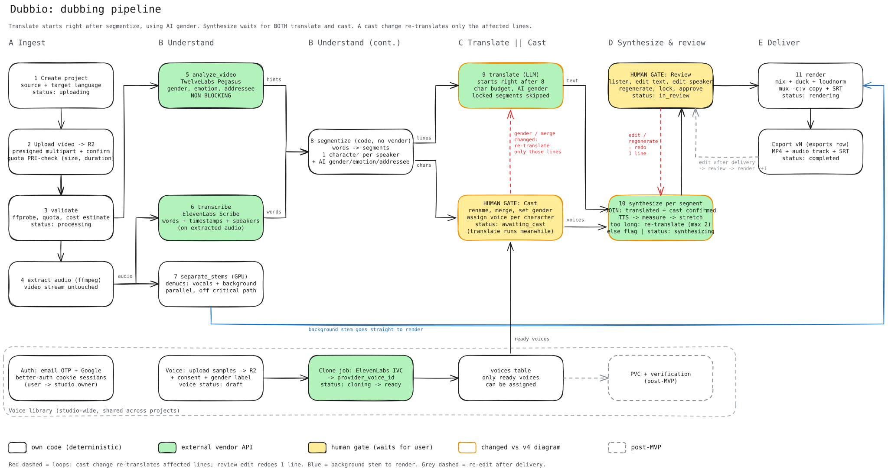

# Dubbio Backend

Dubbio is the backend for an AI-assisted video dubbing studio. It manages
studio access, a shared voice library, project ingestion, the dubbing pipeline,
human review gates, and versioned exports.

The design favors asynchronous, resumable pipeline stages: paid vendor calls are
cached, interrupted polling can resume, and the source video stream is left
untouched until the final render.

> **Project status:** early development. The NestJS bootstrap, environment
> validation, and PostgreSQL schema are in place. The HTTP API, authentication,
> pipeline execution, and vendor integrations are not implemented yet.

## Architecture



The table describes the target architecture. The NestJS bootstrap, environment
validation, database schema and relations, and Docker setup exist in code today;
API behavior and vendor integrations are still planned.

| Component              | Responsibility                                                          |
| ---------------------- | ----------------------------------------------------------------------- |
| NestJS API             | HTTP boundary, authentication, studio/project/voice management, uploads |
| PostgreSQL 18          | Transactional state, pipeline runs, segment versions, exports           |
| Drizzle ORM            | Typed schema, relational queries, SQL migrations                        |
| Cloudflare R2          | Source videos, voice samples, stems, segment audio, rendered exports    |
| better-auth (planned)  | Cookie sessions, email OTP, Google sign-in                              |
| ffmpeg / ffprobe       | Validation, audio extraction, mixing, muxing                            |
| TwelveLabs Pegasus     | Video analysis: gender, emotion, addressee hints                        |
| ElevenLabs Scribe      | Transcription with words, timestamps, and speaker labels                |
| ElevenLabs IVC         | Instant voice cloning from consented samples                            |
| demucs (planned)       | GPU stem separation into vocals and background                          |
| LLM provider (planned) | Dialogue translation and length-aware re-translation                    |

## Dubbing pipeline

The pipeline is organized around two human gates. The cast gate blocks synthesis
until every character has a confirmed voice; the review gate blocks rendering
until the dialogue has been approved.

| Phase              | Stage          | Responsibility                                                                   |
| ------------------ | -------------- | -------------------------------------------------------------------------------- |
| Ingest             | Create project | Record source and target languages; status `uploading`.                          |
| Ingest             | Upload         | Presigned multipart upload to R2 with a quota pre-check; confirm on completion.  |
| Ingest             | Validate       | Inspect with ffprobe, enforce quotas, estimate cost; status `processing`.        |
| Understand         | Extract audio  | Extract the audio track with ffmpeg; keep the video stream untouched.            |
| Understand         | Analyze video  | TwelveLabs Pegasus provides gender, emotion, and addressee hints; non-blocking.  |
| Understand         | Transcribe     | ElevenLabs Scribe returns words, timestamps, and speakers from the audio.        |
| Understand         | Separate stems | demucs extracts vocals and background in parallel, off the critical path.        |
| Understand         | Segmentize     | Deterministic code builds timed segments, one character per speaker, plus hints. |
| Translate and cast | Translate      | LLM translation starts after segmentation; locked segments are skipped.          |
| Translate and cast | Cast gate      | Human renames/merges characters, sets gender, and assigns voices.                |
| Synthesize/review  | Synthesize     | Join translated text with confirmed cast; TTS, measure, stretch, retry.          |
| Synthesize/review  | Review gate    | Human listens, edits text or speaker, regenerates, locks, and approves.          |
| Deliver            | Render         | Mix, duck, and normalize audio; mux with a video stream copy.                    |
| Deliver            | Export         | Persist a versioned MP4 and dubbed audio track; status `completed`.              |

Key pipeline rules from the design:

- The background stem bypasses review and goes directly to the render stage.
- A cast change re-translates only the affected lines.
- A review edit regenerates one segment, not the whole project.
- Editing a delivered project creates a new review and export version.
- Synthesis waits for both translation and the confirmed cast; if a synthesized
  segment is too long, it is re-translated up to two times, then flagged.

`stage_runs` stores one row per stage execution keyed by
`(project_id, stage, input_hash)`. This makes re-runs idempotent and prevents
duplicate paid vendor calls. `vendor_request_id` allows polling to resume
against an existing vendor task.

## Domain model

| Entity             | Purpose                                                                 |
| ------------------ | ----------------------------------------------------------------------- |
| `studios`          | Tenant boundary for projects, voices, and uploads.                      |
| `studio_members`   | User membership and role (`owner`, `editor`, `viewer`).                 |
| `voices`           | Studio-wide voice profiles with consent, provider ID, and status.       |
| `projects`         | Dubbing jobs with language pair and lifecycle status.                   |
| `uploads`          | Multipart upload lifecycle for project videos and voice samples.        |
| `assets`           | Objects stored in R2, classified by kind, content type, and size.       |
| `characters`       | Speakers detected in a project, optionally assigned a voice.            |
| `segments`         | Timed source lines tied to a character and a review state.              |
| `segment_versions` | Translated/synthesized variants with voice, emotion, audio, and status. |
| `stage_runs`       | Execution, caching, and vendor polling state for each pipeline stage.   |
| `exports`          | Render history; each render creates a row for the produced output.      |

Voices are studio-wide. Only a voice in `ready` status can be assigned to a
character; cloning moves a sample through `draft`, `cloning`, and `ready`, with
`failed` and `verification_required` as exception states.

`dubbio.dbml` and [`docs/schema-notes.md`](docs/schema-notes.md) are the source
of truth for the data model. The Drizzle schema in `src/database/schema/`
implements them; check generated migrations against both.

Authentication is not wired yet. `studio_members.user_id`,
`projects.created_by`, and `voices.created_by` are UUID columns reserved for the
better-auth user table; their foreign keys will be added when that schema is
integrated.

## Tech stack

| Area            | Choice                                                       |
| --------------- | ------------------------------------------------------------ |
| Runtime         | Node.js 26 in Docker, TypeScript 6, ESM                      |
| Framework       | NestJS 12 with `@nestjs/drizzle`                             |
| Database        | PostgreSQL 18, Drizzle ORM 1.0 RC, drizzle-kit               |
| Validation      | Zod 4                                                        |
| Package manager | pnpm 10.33                                                   |
| Tooling         | oxlint (type-aware), Prettier                                |
| Delivery        | Multi-stage Docker image; Compose manifests for dev and prod |

## Repository layout

```text
src/
  main.ts                 Application bootstrap and shutdown hooks
  app.module.ts           Nest module and Drizzle registration
  config/env.ts           Zod-validated environment
  database/
    schema/               Drizzle table definitions and enums
    relations.ts          Relational query definitions
drizzle/                  Generated SQL migrations
drizzle.config.ts         Drizzle Kit configuration
dubbio.dbml               DBML design reference
docker-compose.yml        Development stack (PostgreSQL + API)
docker-compose.prod.yml   Production stack
Dockerfile                Development, build, and runtime stages
```

## Getting started

Requirements:

- Docker with Compose.
- The `node:26-trixie` and `postgres:18` images available locally, or network
  access to pull them.

The initial migration is not committed yet. Generate it once before the first
start; the one-off container writes the migration to the host's `drizzle/`
directory:

```bash
cp .env.example .env
docker compose run --rm --no-deps --build api pnpm db:generate --name=init
docker compose up --build
```

The `api` container installs dependencies, applies the migration, and runs Nest
in watch mode. Source files are mounted from the host, so changes reload
automatically. The process listens on <http://localhost:3000>; no HTTP routes
are registered yet.

Commit the generated `drizzle/` directory so other environments apply the same
schema. After that, migrations run automatically whenever the `api` container
starts.

Stop the stack or reset its data:

```bash
docker compose down
docker compose down -v   # also deletes the database and dependency volumes
```

## Commands

Run scripts inside the running `api` container:

```bash
docker compose exec api pnpm <script>
```

| Script                           | Purpose                              |
| -------------------------------- | ------------------------------------ |
| `pnpm start:dev`                 | Run Nest in watch mode               |
| `pnpm build`                     | Compile to `dist/`                   |
| `pnpm start:prod`                | Run the compiled application         |
| `pnpm typecheck`                 | Type-check the project               |
| `pnpm lint`                      | Lint the source                      |
| `pnpm format`                    | Format the source and Markdown files |
| `pnpm db:generate --name=<name>` | Generate a migration                 |
| `pnpm db:migrate`                | Apply pending migrations             |
| `pnpm db:check`                  | Check migration snapshots            |
| `pnpm db:studio`                 | Start the Drizzle Studio UI          |

After adding a dependency, rebuild the image so it remains reproducible:

```bash
docker compose exec api pnpm add <package>
docker compose up -d --build
```

## Configuration

`.env.example` contains working defaults and is consumed by Docker Compose:

| Variable                                              | Default  | Purpose                                |
| ----------------------------------------------------- | -------- | -------------------------------------- |
| `POSTGRES_USER` / `POSTGRES_PASSWORD` / `POSTGRES_DB` | `dubbio` | Database container credentials         |
| `POSTGRES_PORT`                                       | `5432`   | Host port for the development database |
| `API_PORT`                                            | `3000`   | Host port for the API                  |

Compose builds `DATABASE_URL` from the PostgreSQL variables and injects it into
the API. The application validates `DATABASE_URL` and an optional `API_PORT`
(default `3000`) with Zod at startup, and exits if they are invalid. In Compose,
`API_PORT` controls the published host port; the process inside the container
listens on `3000`.

For local runs outside Docker, the application also loads a `.env` file when one
is present.

## Database workflow

1. Edit the table definitions in `src/database/schema/` and export new tables
   from `index.schema.ts`.
2. Generate a migration and review the SQL before applying it:

   ```bash
   docker compose exec api pnpm db:generate --name=add_project_tags
   # review drizzle/<timestamp>_add_project_tags/migration.sql
   docker compose exec api pnpm db:migrate
   ```

3. Never edit an applied migration. Add a new migration instead.

Use `pnpm db:generate --custom --name=<name>` for SQL that Drizzle Kit cannot
express, such as extensions, deferrable constraints, or partial indexes.

The development `api` command applies pending migrations on startup. In
production, migrations must run as a separate one-shot step before the API
starts.

## Production

The `runtime` stage in the Dockerfile contains only production dependencies, the
compiled application, and the migration files. `docker-compose.prod.yml` keeps
PostgreSQL off the host network and requires an explicit
`POSTGRES_PASSWORD`.

Production deployment is not complete yet. The intended flow is a one-shot
migration service followed by the API, but the `migrate` service is currently
commented out while `api` depends on it, and the compiled migration entrypoint
(`dist/database/migrate.js`) does not exist. Generate and commit the initial
migration before building this image as well; the runtime stage copies the
`drizzle/` directory. Treat the production stack as pending until that wiring is
finished.

## Current status

| Area                             | State                                      |
| -------------------------------- | ------------------------------------------ |
| NestJS bootstrap and shutdown    | Implemented                                |
| Zod environment validation       | Implemented                                |
| Drizzle schema, enums, relations | Implemented                                |
| Multi-stage Dockerfile           | Implemented                                |
| Development Compose stack        | Implemented                                |
| Initial migration                | Not committed; generate before first use   |
| HTTP API modules                 | Not implemented                            |
| better-auth integration          | Not implemented; user foreign keys pending |
| R2 upload endpoints              | Not implemented                            |
| Pipeline orchestration           | Not implemented                            |
| Vendor adapters                  | Not implemented                            |
| Automated tests                  | None yet                                   |
| Production migration service     | Not implemented                            |

## Documentation

| File                                                                   | Holds                                         |
| ---------------------------------------------------------------------- | --------------------------------------------- |
| [`docs/queue.md`](docs/queue.md)                                       | Queues, jobs, payloads, events, pipeline flow |
| [`docs/errors.md`](docs/errors.md)                                     | Error response shape and error codes          |
| [`docs/schema-notes.md`](docs/schema-notes.md)                         | Database rules `dubbio.dbml` can't express    |
| [`docs/glossary.md`](docs/glossary.md)                                 | Project terms                                 |
| [`docs/adr/`](docs/adr/)                                               | Decisions; start from `0000-template.md`      |
| [`docs/module-readme-template.md`](docs/module-readme-template.md)     | Template for `src/modules/<name>/README.md`   |
| [`.github/pull_request_template.md`](.github/pull_request_template.md) | PR description sections                       |

## Development conventions

- The project is ESM; relative imports use the `.js` extension.
- Tables use `snakeCase.table`, so TypeScript fields stay camelCase while
  PostgreSQL columns stay snake_case.
- Shared timestamp columns come from
  `src/database/schema/helpers/columns.helpers.ts`.
- Exported tables must be listed in `index.schema.ts` and, when needed, wired
  into `relations.ts`.
- Run `pnpm format`, `pnpm lint`, and `pnpm typecheck` before committing.
- Treat migrations as append-only once applied.

## License

Private and unlicensed. See `package.json`.
